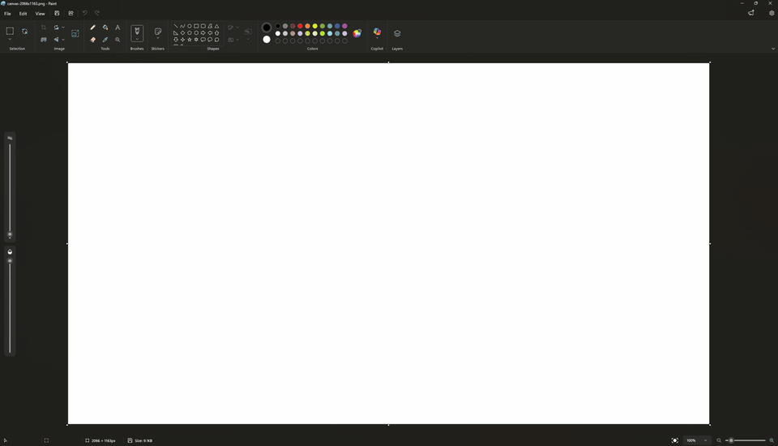

# Paint Presentator

**Your slides, live in Microsoft Paint.**

Have you ever sat through one more deck, in one more PowerPoint, and
thought: *this would be better in Paint*? Have you ever wanted to walk up
to the projector, open MS Paint, and give a perfectly serious talk in it,
while the room slowly works out what is going on?

Now you can. Point Paint Presentator at your deck (PowerPoint, PDF, Marp
or Slidev) and it opens Paint, paints a little picture while your slides
get ready, and then puts every slide into Paint, pixel for pixel, as you
press the arrow keys. No plugin, no video, no second app on the screen.
It is just Paint. Mostly.



## Try it

Windows 11, with Paint from the Microsoft Store. No admin rights needed.

```powershell
irm https://github.com/Laffs2k5/ms-paint-presentator/releases/latest/download/install.ps1 -OutFile install.ps1
.\install.ps1
presenter                      # the built-in help deck, in Paint
presenter present talk.pptx    # your own
```

[Installing](docs/install.md) has the details: Node.js for Marp decks, and
what to do on a managed work computer that blocks new programs.

## What it does

- **Any deck you already have.** PowerPoint (`.pptx`, `.ppt`), PDF, Marp
  Markdown, a Slidev project, or a folder of images. Each is rendered by
  its own tool, at the exact size of Paint's canvas on your screen, and
  cached for next time.
- **A loading painting.** While the deck renders, Paint draws a picture by
  itself, with a synthetic pen and Paint's own brushes: your title, a sun,
  a cloud, and a progress bar that tracks real slides. Then the sky leaks.
- **Fast slides.** About 200 ms from key press to slide. Right or Space
  forward, Left back, digits and Enter to jump, B or W for a black or white
  screen, Esc to end.
- **Paint stays in line.** Closed, moved, zoomed or un-maximised, Paint is
  put back, and a stray Ctrl+Z cannot touch your slide.
- **Cables happen.** Pull the projector mid-talk and a screen picker waits
  for you; plug it back in and the show carries on at the same slide.
- **`presenter doctor`** checks the computer and Paint before you go on
  stage.

## How it works, briefly

Each slide becomes a PNG the size of Paint's canvas. The presenter offers it
on the clipboard, presses Ctrl+V and S in Paint, and checks that it landed.
The loading painting is drawn live through Windows' pen input, choosing
Paint's tools over UI Automation. The details, and everything that was
measured on the way, are in [`src/README.md`](src/README.md).

## Behind the scenes

This started as a proof of concept: can Paint be driven fast and reliably
enough to present from? The answers are written up.

- **Research:**
  1. [Streaming pictures/video into MS Paint](docs/research/01-streaming-frames-into-ms-paint.md):
     the podcast episode, DoomPaint, slow vs fast clipboard methods, measured
     frame rates, prior art.
  2. [OLE in DoomPaint and Paint's integration surface](docs/research/02-ole-and-paint-integration-surface.md):
     the live `IDataObject`, what Paint consumes and exposes over OLE/COM/UIA,
     and the background-paste hypothesis.
  3. [Authoring, rendering and PPTX](docs/research/03-authoring-rendering-and-pptx.md):
     build-then-present architecture, the deck bundle format,
     Slidev/Marp/reveal.js adapters, live rendering options, and tiered PPTX
     import.
  4. [Instrumenting Paint](docs/research/04-instrumenting-paint.md): Windows
     automation MCPs vs a purpose-built tool, and how we measure the render
     area in physical pixels.
  5. [The presenter's architecture](docs/research/05-presenter-architecture.md).
- **The POC:** the [plan](docs/poc-plan.md) (experiments and the decisions
  they unlock) and the [results](docs/poc-results.md) (what each one found).
- **The loading painting's design:** [The sky leaks](docs/loading-painting.md).
- **Tools:** [`poc/paintctl`](poc/paintctl), a CLI and MCP server to launch,
  size, maximise, measure, zoom, screenshot and UIA-dump Paint.

## License

[MIT](LICENSE). Not affiliated with or endorsed by Microsoft. Microsoft
Paint and PowerPoint are trademarks of Microsoft.
